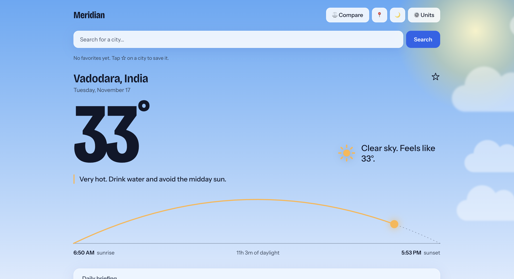

# Meridian: a weather app with an AI assistant

A responsive weather app built with React and Vite, using the free [Open-Meteo API](https://open-meteo.com/). The weather sets the look of the page: the sky, the clouds, and even the weight of the temperature numerals change with the forecast. A serverless function connects it to an AI model for a daily briefing and a chat box.

**Live demo:** [add link after deploying]

## Features

- Search any city, or get your own weather automatically with geolocation
- Current conditions, feels like, humidity, wind, precipitation, UV index, visibility, and air pressure
- **AI daily briefing**: a short written summary of the day, built from the real forecast
- **Ask Meridian**: a chat box that answers questions like "Do I need an umbrella tomorrow evening?" using the forecast data
- Plain-language advice line (umbrella, sunscreen, jacket)
- Interactive hourly temperature curve with rain-chance bars (hover, tap, or use arrow keys)
- 7-day forecast as range bars on a shared scale
- Sun position on a horizon arc, with sunrise and sunset times
- Animated sky that changes with the weather and time of day (rain, snow, storm, fog, stars)
- Light and dark mode
- Metric/Imperial switch, plus separate temperature, wind, and precipitation units
- Favorite locations and a side-by-side compare view (up to 4 places)
- Custom SVG weather icons, responsive layout, keyboard focus states, and reduced-motion support

## Tech stack

React, Vite, plain CSS (variable fonts, custom properties, SVG), Open-Meteo Forecast and Geocoding APIs, BigDataCloud reverse geocoding, a Vercel-style serverless function (`api/ai.js`) calling the Gemini API, localStorage

## How the AI part works

The browser never sees the API key. The React app sends a compact summary of the forecast to `/api/ai`. That function adds the instructions, calls the AI model with the secret key, and returns plain text. It validates and caps every request, retries when the service is busy, and falls back to a second model.

## Run locally

    git clone https://github.com/[your-username]/[repo-name].git
    cd [repo-name]
    npm install
    cp .env.example .env.local

Open `.env.local`, add your own key from [Google AI Studio](https://aistudio.google.com/), then:

    npm run dev

The weather features work without a key. Only the briefing and chat need it.

## What I learned

- Fetching and combining data from several APIs
- React state, effects, and custom hooks
- Persisting state with localStorage
- Building interactive SVG charts without a chart library
- Keeping API keys secret with a serverless function
- Designing a distinctive, accessible, responsive interface